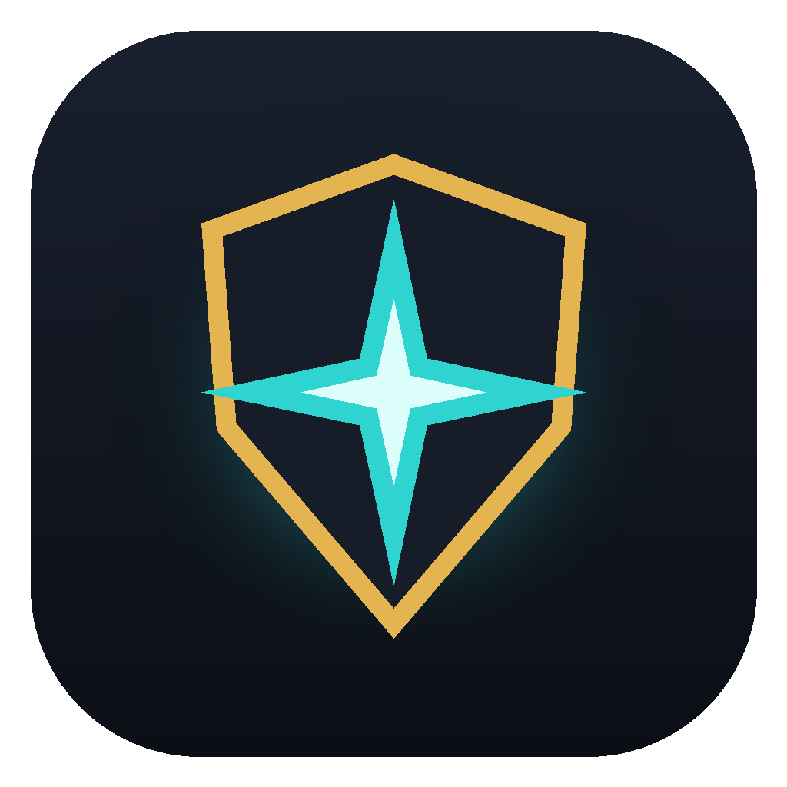

<p align="center"></p>

<h1 align="center">Custom Skin Studio</h1>

<p align="center">
League of Legends custom skin paketlerini (<code>.fantome</code>) açan, düzenleyen ve yeni sürüm olarak kaydeden masaüstü uygulaması.<br>
<a href="../../releases/latest"><b>⬇ Son sürümü indir</b></a> · Windows · macOS
</p>

> **Uyarı:** Riot Games custom skin kullanımına izin vermez; hesap riski kullanıcıya aittir. Bu uygulama yalnızca görsel ve ses
> dosyalarını değiştirir, oyun verisine dokunmaz. Riot Games ile bir bağlantısı yoktur. Uygulama Riot dosyası içermez,
> yalnızca senin oyun kurulumunu okur.

## Kurulum
**Windows:**
1. [Releases](../../releases/latest) sayfasından `CustomSkinStudio-Setup-x.y.z.exe` dosyasını indir ve çalıştır.
2. Kurulum, gereken Microsoft Visual C++ bileşenlerini kendisi kurar. Kurarken istersen `.fantome` dosyalarını uygulamayla ilişkilendirebilirsin.

Kurulum yapmak istemezsen `...-windows-portable.zip` dosyasını indir, bir klasöre aç ve `CustomSkinStudio.exe`'yi çalıştır.

> Windows SmartScreen "tanınmayan uygulama" uyarısı gösterebilir, çünkü uygulama imzalı değil. **Ek bilgi → Yine de çalıştır** ile açabilirsin.

**macOS** (Apple Silicon, M1 ve sonrası; macOS 12 ve üstü):
1. `CustomSkinStudio-x.y.z-macos.dmg` dosyasını indir.
2. Uygulamayı **Applications** klasörüne sürükle.
3. İlk açılışta uygulamaya **sağ tıkla → Aç** de. Uygulama Apple tarafından imzalanmadığı için bu adım gerekiyor.

## Kullanım
1. Uygulamayı aç ve bir `.fantome` dosyasını pencereye sürükle (ya da **Dosya seç**).
2. İlk açılışta **oyun klasörünü** seç. Windows'ta genelde `C:\Riot Games\League of Legends` olur. İskelet, animasyonlar ve paketin taşımadığı dokular buradan okunur.
3. Sol menüden düzenlemek istediğin şeyi seç:

| Bölüm | Ne yapar |
|---|---|
| **Renkler** | Gövde, silah ve kafa dokularındaki renk bölgeleri otomatik bulunur. Modelde bir yere tıklamak o bölgeyi seçer. Bölgeye hazır ya da özel renk verilebilir; ton, doygunluk, parlaklık ve kontrast ayarlanabilir. Doku çözünürlüğü değişmez. |
| **Efektler** | Efektler Pasif, Q, W, E, R, temel saldırı ve bekleme parıltısı olarak gruplanır. Hepsine tek renk ya da her yeteneğe ayrı renk verilebilir. |
| **Sesler** | Her yetenek için bir kart vardır. Karta ses dosyası sürüklenebilir (wav, mp3, ogg, opus, m4a, flac), mikrofonla kayıt yapılabilir ya da ses sessize alınabilir. Kırpma, ses seviyesi ve yumuşak giriş/çıkış ayarlanabilir. **Dinle** sesi ilgili animasyonla birlikte çalar. |
| **Yükleme ekranı** | Oyun yüklenirken görünen görseli değiştirir. Görsel oyunun oranında (308×560) kırpılır. |
| **Paket** | Ad, yapan, sürüm, açıklama ve kapak görseli. |

4. **Yeni sürüm olarak kaydet**'e bas. Açtığın paketin üzerine yazılmaz, yeni bir `.fantome` oluşur. Bunu ROSE ya da LTK Manager ile kur.

Önizleme gerçek zamanlı 3D'dir: model oyundaki gibi tek yüzlü çizilir ve bütün animasyonlar oynatılabilir. Efekt parçacıklarının hareketi ise uygulamada oynamaz; son görüntüyü oyunda kontrol et.

## Kaynaktan derleme
Gereken: Qt 6.8 ya da üstü (Quick, Quick 3D, Multimedia, ShaderTools), CMake 3.24+, Ninja ve C++20 derleyici (MSVC 2022, Clang ya da GCC).
```
cmake -S . -B build -G Ninja -DCMAKE_BUILD_TYPE=Release -DCMAKE_PREFIX_PATH=<Qt yolu>
cmake --build build
```
`zstd`, `xxHash` ve `miniz` derleme sırasında kendiliğinden indirilir. Sürüm etiketi (`v*`) atıldığında GitHub Actions şunları üretip Releases'a koyar:
- Windows kurulum dosyası
- Windows taşınabilir zip
- macOS dmg

**Testler:**
```
build/skincore_tests <paket.fantome> <oyun klasörü> <çıktı klasörü>
```
Bu komut gerçek bir paketle şunları kontrol eder:
- WAD, BIN, BNK ve WPK dosyalarının baytı baytına aynı yeniden yazılması;
- doku kodlaması;
- animasyonların okunması;
- değiştirilmeden yapılan kayıtta paketin aynı kalması;
- düzenlenmiş kayıtta değişikliklerin pakete girmesi.

Ekran görüntüsü modu: `CustomSkinStudio --open <paket> --mode colors|effects|voice|loadscreen|package --screenshot out.png`.

## Kod düzeni
- `src/core/`: League dosya biçimleri ve düzenleme mantığı (WAD, BIN, SKN/SKL/ANM, TEX/DDS, Wwise BNK/WPK, ses işleme, renk bölgeleri, efektler). `SkinProject` paketi açar ve kaydeder.
- `src/app/`: Qt uygulama katmanı: 3D model ve CPU skinning, ses motoru, görsel sağlayıcı.
- `qml/`: Arayüz.
- `installer/`: Windows kurulum dosyası (Inno Setup).
- `.github/workflows/`: Windows ve macOS derlemeleri ile sürüm yayınlama.

## English
Custom Skin Studio opens a League of Legends custom skin package (`.fantome`), lets you recolor the model and ability
effects, replace or record ability voice lines, change the loading-screen art, and saves the result as a new `.fantome`
for ROSE / LTK Manager. Download the installer from [Releases](../../releases/latest). The UI is in Turkish.
Not affiliated with Riot Games. Using custom skins is against Riot's terms; use at your own risk.

Lisans: [MIT](LICENSE) · Üçüncü taraf bileşenler: [THIRD_PARTY_NOTICES.md](THIRD_PARTY_NOTICES.md)
